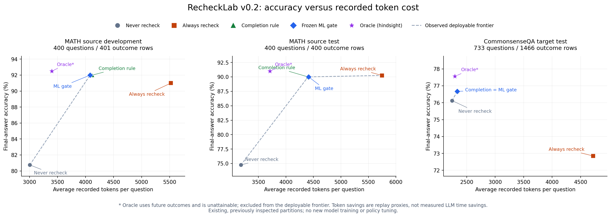

# RecheckLab: professor-ready ML contribution summary

The frozen classifier and the answer-retention policy are different evaluations. All numbers below use existing v0.2 records; test sets were previously inspected.

## ML classifier itself

| Dataset | 3-class accuracy | Macro-F1 | Weighted-F1 | Log loss | HELP precision / recall | HURT recall |
|---|---:|---:|---:|---:|---:|---:|
| MATH source test | 85.2500% | 0.541671 | 0.869121 | 0.411111 | 58.82% / 92.31% | 0.00% |
| CommonsenseQA target test | 91.5416% | 0.393647 | 0.900151 | 0.322128 | 16.00% / 38.10% | 0.00% |

NO_CHANGE is 83.00% of source-test outcomes and 93.8608% of target-test outcomes. An always-NO_CHANGE predictor reaches 93.8608% target classification accuracy, above the model's 91.5416%; its poor rare-class detection is exposed by macro-F1 and class-specific recall.

## Answer accuracy and recorded token trade-off

| Dataset / policy | Final accuracy | Recheck | Avg. tokens | Total tokens saved | HELP captured | HURT incurred |
|---|---:|---:|---:|---:|---:|---:|
| MATH source test / Never recheck | 74.7500% | 0.000% | 3182.02 | 44.64% | 0.00% | 0 |
| MATH source test / Always recheck | 90.2500% | 100.000% | 5747.44 | 0.00% | 100.00% | 3 |
| MATH source test / Completion rule | 90.0000% | 26.750% | 4402.42 | 23.40% | 95.38% | 1 |
| MATH source test / Frozen ML gate | 90.0000% | 27.250% | 4412.82 | 23.22% | 95.38% | 1 |
| MATH source test / Oracle (hindsight) | 91.0000% | 16.250% | 3707.84 | 35.49% | 100.00% | 0 |
| CommonsenseQA target test / Never recheck | 76.1255% | 0.000% | 2243.60 | 52.47% | 0.00% | 0 |
| CommonsenseQA target test / Always recheck | 72.8513% | 100.000% | 4719.98 | 0.00% | 100.00% | 34.5 |
| CommonsenseQA target test / Completion rule | 76.6712% | 3.411% | 2334.85 | 50.53% | 38.10% | 0 |
| CommonsenseQA target test / Frozen ML gate | 76.6712% | 3.411% | 2334.85 | 50.53% | 38.10% | 0 |
| CommonsenseQA target test / Oracle (hindsight) | 77.5580% | 1.432% | 2291.70 | 51.45% | 100.00% | 0 |

HELP capture is selected HELP / all HELP, not helpful-recheck precision. Counts are question-equivalents. Oracle is a per-outcome hindsight bound selecting HELP only and skipping neutral/harmful outcomes; it is not an attainable learned model. Its target fractional counts/calls are not literal unique questions.

The gate captures 62/65 HELP outcomes on source test (95.38%), with 62/109 helpful rechecks (56.88% precision). It selects 1 harmful recheck (0.917% of selected; 0.25% of all questions). On target test it captures 4/10.5 HELP question-equivalents (38.10%); 4/25 selected outcomes are helpful (16%), 21 are neutral, and none is harmful. Zero observed harm is not a guarantee.

The three-class source HELP recall is 92.31%, different from policy HELP capture 95.38%: the gate uses P(HELP)-P(HURT)>0.25968145276947807, not argmax HELP. HURT argmax recall is zero on both tests; the policy's avoided harms do not establish successful HURT classification.

## Efficiency and timing

Source-test gate: 23.2210% total-token savings and 52.0231% recheck-token savings versus always; 291/400 recheck calls avoided, with -0.25 percentage points answer accuracy versus always. Target-test gate: 50.5327% total-token savings and 96.3155% recheck-token savings; 708/733 calls avoided, with +3.8199 points answer accuracy versus always.

Source development is separate: gate 92.00%, 4,081.3425 tokens versus always 91.00%, 5,521.67625 tokens. That is 26.0851% total-token savings, 57.2460% recheck-token savings and 307/400 calls avoided. Completion ties 92% using 4,121.0125 tokens.

No trustworthy original LLM wall-time/latency records exist. Token/call savings are replay counterfactuals using actual recorded token counts, not observed collection savings or measured seconds saved. Historical offline experiment runtime is not LLM runtime.

Current offline MATH source test gate overhead: single-record median 4.127 ms, p95 4.551 ms; batch amortized 0.2058 ms/initial record. Includes feature extraction and compatibility validation; excludes loading, UI and LLM work.
Current offline CommonsenseQA target test gate overhead: single-record median 3.999 ms, p95 4.504 ms; batch amortized 0.0655 ms/initial record. Includes feature extraction and compatibility validation; excludes loading, UI and LLM work.

## Does ML beat the heuristic?

Target policies are identical. On source test completion achieves the same 90% with 4,402.420 tokens versus gate 4,412.825, so completion dominates the gate there. The gate's small development token advantage does not establish a held-out ML advantage.

Observed deployable Pareto frontier: source development = never/gate; source test = never/completion/always; target test = never and the coincident completion/gate. Oracle is excluded.

## Strongest defensible contribution and readiness

Ready to present as a reproducible selective-compute evaluation with leakage safeguards, grouped rollout accounting, explicit token costs and strong baseline comparisons. The evidence supports useful selective rechecking relative to always rechecking, but does not demonstrate that the learned classifier outperforms the simple completion heuristic. It is not an 80%-accuracy system or a demonstrated end-to-end latency improvement.

